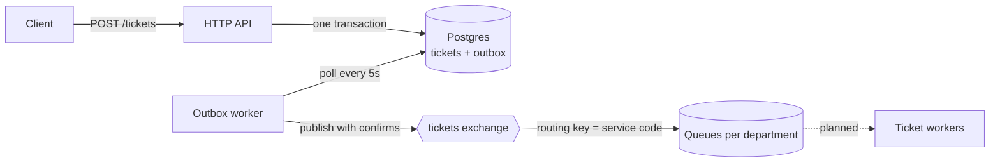

# Queueing System

A ticket queue system for government offices and other public service points, where people take a number and wait to be called. A visitor picks the service they need, gets a ticket number like `PN-042`, and waits in line. Tickets are sent to RabbitMQ, where workers will pick them up and process them.

The project's focus is reliable delivery: every ticket that is created is guaranteed to reach the queue, even if RabbitMQ is down when the ticket is issued. This is done with the **transactional outbox pattern**.

## How it works



1. **Request a service.** The client sends a service code, such as `passport_new`.
2. **Issue a ticket.** In a single transaction the API:
   - locks today's counter for that service and takes the next number (`PN-001`, `PN-002`, …; numbers restart every day),
   - inserts the ticket,
   - inserts a `ticket.created` event into the `outbox` table.
3. **Publish.** A background worker reads unpublished outbox rows in creation order and publishes each one to RabbitMQ, waiting for a publisher confirm. On success the row is marked as published; on failure the attempt count and error are saved, and the row is retried on the next poll.
4. **Route.** The `tickets` direct exchange routes each message by service code to its department queue.

### Why an outbox

Without it, the API would save the ticket and then publish to RabbitMQ as two separate steps. If the app crashed or RabbitMQ was unavailable between them, the visitor would hold a ticket that never reaches the queue.

With the outbox, the ticket and its event are committed together, so either both exist or neither does. Publishing happens afterwards, and is retried until it succeeds.

Delivery is **at-least-once**: if the worker crashes after RabbitMQ confirms a message but before the row is marked as published, the message is sent again. Each message carries a unique `MessageId` (the event id), so consumers can ignore duplicates.

## Tech stack

- **Go** with [fx](https://github.com/uber-go/fx) for dependency injection and lifecycle
- **Gin** for HTTP, with Swagger docs via [swag](https://github.com/swaggo/swag)
- **PostgreSQL 18**, queried with [go-jet](https://github.com/go-jet/jet) (type-safe SQL generated from the schema)
- **RabbitMQ** with publisher confirms and persistent messages
- **goose** for migrations, **Task** for scripts, **golangci-lint** in CI

## Getting started

### Prerequisites

- Go 1.27+
- Docker and Docker Compose
- [Task](https://taskfile.dev), [goose](https://github.com/pressly/goose) and the [jet](https://github.com/go-jet/jet) generator:

```bash
go install github.com/go-task/task/v3/cmd/task@latest
go install github.com/pressly/goose/v3/cmd/goose@latest
go install github.com/go-jet/jet/v2/cmd/jet@latest
```

### Run

```bash
cp .env.example .env          # adjust values if needed
docker compose up -d          # Postgres + RabbitMQ
task migrate-up               # apply migrations and regenerate jet models
go run .
```

The API listens on `HTTP_HOST:HTTP_PORT` from `.env` (`localhost:1111` by default).

## API

### `GET /services`

Lists the services a visitor can choose from.

Response:

```json
[
  { "id": "01a15d53-…", "service_code": "passport_new", "name": "Apply for a new passport", "is_active": true }
]
```

### `POST /tickets`

Requests a service and issues a ticket.

Request:

```json
{ "service_code": "passport_new" }
```

Response:

```json
{
  "id": "01a1785f-846a-72df-829d-5c82f5218817",
  "number": "PN-004",
  "service_code": "passport_new",
  "status": "new",
  "created_at": "2026-10-26T13:21:28.15892Z"
}
```

| Status | Meaning |
|---|---|
| `201` | Ticket created |
| `400` | Invalid body or missing `service_code` |
| `404` | Unknown service |
| `409` | Service is not active |

## Queues

Each service is routed to one department queue:

| Queue | Services |
|---|---|
| `tickets.identity` | passport and ID card applications and collections |
| `tickets.tax` | tax registration, declarations, certificates, business registration |
| `tickets.transport` | vehicle registration, driving licences, parking permits |
| `tickets.civil` | birth and marriage certificates, marriage registration, criminal record |
| `tickets.residence` | address registration and deregistration, building permits, complaints |

Messages are JSON with `type` set to the event name (`ticket.created`) and `message_id` set to the event id:

```json
{ "id": "01a1785f-…", "number": "PN-004", "service_code": "passport_new", "created_at": "2026-10-26T13:21:28.15892Z" }
```

## Configuration

All settings come from environment variables (or `.env`). See [`.env.example`](.env.example) for the full list.

| Variable | Default | Description |
|---|---|---|
| `HTTP_PORT` | `1111` | API port |
| `RABBITMQ_EXCHANGE` | `tickets` | Exchange tickets are published to |
| `RABBITMQ_PUBLISH_TIMEOUT` | `5s` | Max wait for a publisher confirm |
| `OUTBOX_POLL_INTERVAL` | `5s` | How often the outbox worker checks for new events |
| `OUTBOX_BATCH_SIZE` | `50` | Max events published per poll |
| `LOG_LEVEL` | `info` | `debug`, `info`, `warn` or `error` |

## Project layout

```
app/                   fx wiring: providers and start/stop hooks
config/                environment config
internal/
  domain/              tickets, services, outbox events
  database/            Postgres repository (jet), transactions
    gen/               generated jet models (do not edit)
  broker/              RabbitMQ connection, exchange, queues, publishing
  service/
    services/          request a service, list services
    outbox/            outbox worker: polls, publishes, marks events
server/                HTTP server and handlers
migrations/            goose SQL migrations
docs/                  generated Swagger spec
```

## Known limitations

- **No RabbitMQ reconnect.** If the connection drops, publishing fails until the app restarts. No tickets are lost: events wait in the outbox and go out after the restart.
- **Single outbox worker.** The worker assumes it is the only instance. Running several would need `SELECT … FOR UPDATE SKIP LOCKED` inside a transaction so they don't publish the same rows.
- **At-least-once delivery.** Consumers must deduplicate by `MessageId`.
